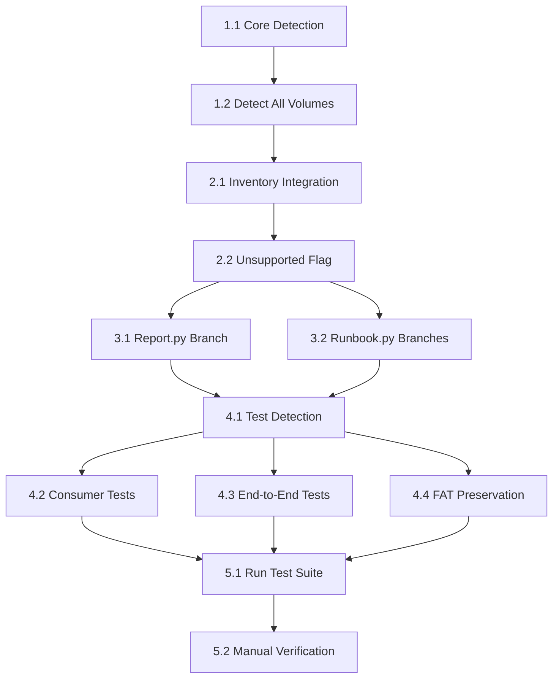

# Tasks: Filesystem Detection

## Overview
Implement NTFS, exFAT, and unknown filesystem detection from boot-sector signatures. Add detection, inventory labels, and synthetic tests. Preserve existing FAT detection unchanged. Ensure truthful report/runbook output for unsupported filesystems.

## Task List

### Phase 1: Core Detection Functions

- [ ] **Task 1.1: Add `detect_filesystem_at_offset()` to image.py**
  - **Input**: Full image data (`bytes`) and byte offset (`int`)
  - **Output**: `"FAT12"`, `"FAT16"`, `"FAT32"`, `"NTFS"`, `"exFAT"`, or `"Unknown"`
  - **Logic**:
    1. Extract 512-byte sector slice from `data[offset:offset + 512]`
    2. If slice length < 512: return `"Unknown"`
    3. Check bytes 3:11 for signatures:
       - `b"NTFS    "` → `"NTFS"`
       - `b"EXFAT   "` → `"exFAT"`
    4. Try `FatVolume(data, offset)` construction:
       - Success: return `FatVolume.kind` (`"FAT12"`, `"FAT16"`, `"FAT32"`)
       - `FatError`: return `"Unknown"`
  - **Tests**: Unit tests for exact signatures, malformed variants, short data

- [ ] **Task 1.2: Add `detect_all_volumes()` to image.py**
  - **Input**: Full image data (`bytes`)
  - **Output**: List of dictionaries with detection results
  - **For each detected volume**:
    - **All volumes**: `where`, `fs_raw`, `fs`, `unsupported` (bool)
    - **FAT volumes**: `fat_volume`, `size_bytes`, `bytes_used`, `files`, `label`, `oem`, `os`, `boot_files_present`, `boot_files_missing`, `config_files`
    - **Non-FAT volumes**: `size_bytes=None`, `bytes_used=None`, `files=0`, `label=""`, `oem=""`, `os="Unknown"`, empty lists/dicts
  - **Logic**: Reuse `partitions()` and `detect_filesystem_at_offset()`
  - **Preserves**: `volumes()` function unchanged (returns `(description, FatVolume)` pairs)

### Phase 2: Inventory Integration

- [ ] **Task 2.1: Modify `inventory.inspect()` to use `detect_all_volumes()`**
  - Replace `vols = img.volumes(data)` with `detected = img.detect_all_volumes(data)`
  - **For FAT volumes**: Process normally with existing logic (unchanged)
  - **For non-FAT volumes**: Use pre-built dictionary from detection
  - **Warning messages**: Specific detection warnings ("NTFS volume detected (not readable)")

- [ ] **Task 2.2: Add `unsupported` flag to non-FAT volume entries**
  - Set `"unsupported": True` for NTFS, exFAT, Unknown volumes
  - Set `"unsupported": False` or omit for FAT volumes
  - Used by report/runbook for truthful output

### Phase 3: Report/Runbook Truthfulness (Minimal Branches)

- [ ] **Task 3.1: Add unsupported branch in `report.py`**
  - **File**: `legacyrescue/report.py` line ~28
  - **Current**: `html.escape(v["fs"] + ", " + str(v["files"]) + " files")`
  - **Amendment**: Check `v.get("unsupported")`
    - If unsupported: `html.escape(v["fs"])` (no file count)
    - Else: `html.escape(v["fs"] + ", " + str(v["files"]) + " files")`

- [ ] **Task 3.2: Add unsupported branches in `runbook.py`**
  - **File**: `legacyrescue/runbook.py`
  - **Lines 31-33 (evidence table)**:
    ```python
    if v.get("unsupported"):
        a("| Filesystem %s detected | NOT READABLE |" % v["fs"])
        # No OS guess line for unsupported
    else:
        a("| Filesystem %s, %d files readable | MEASURED |" % (v["fs"], v["files"]))
        a("| OS guess: %s | MEASURED (file names only) |" % v["os"])
    ```
  - **Line 62 (inventory list)**:
    ```python
    if v.get("unsupported"):
        a("- %s: %s (detected, not readable)" % (v["where"], v["fs"]))
    else:
        a("- %s: %s, label `%s`, %d files, OS: %s" % (v["where"], v["fs"], v["label"], v["files"], v["os"]))
    ```

### Phase 4: Test Suite

- [ ] **Task 4.1: Create `tests/test_filesystem_detection.py`**
  - **Exact signature tests**: Canonical "NTFS    ", "EXFAT   " (3+8+499+2=512)
  - **Malformed signature tests**: Reject "NTFS   X", "EXFAT  A", etc.
  - **MBR offset tests**: Non-zero partition offsets, mixed filesystems
  - **Truncated/random input**: Short data (<512 bytes), damaged sectors

- [ ] **Task 4.2: Add consumer safety tests**
  - **Report integration**: `report.py` doesn't crash, correct wording
  - **Runbook integration**: `runbook.py` doesn't crash, correct wording
  - **Assertions**: Verify "NOT READABLE" for unsupported, "MEASURED" for FAT

- [ ] **Task 4.3: Add end-to-end tests**
  - **Bare unsupported**: Image with only NTFS/exFAT/Unknown volumes
  - **Mixed partitions**: Unsupported first, FAT second (tests ordering)
  - **Consumer output**: Verify truthful labeling in report/runbook

- [ ] **Task 4.4: Verify FAT preservation**
  - **Existing tests**: `test_core.py`, `test_fuzz.py` pass unchanged
  - **New tests**: Verify FAT detection identical to baseline

### Phase 5: Validation

- [ ] **Task 5.1: Run full test suite**
  - Command: `C:\Python314\python.exe -m unittest discover tests`
  - All existing tests must pass
  - All new tests must pass

- [ ] **Task 5.2: Manual verification**
  - Synthetic test images produce expected output
  - Report/runbook output is truthful for unsupported filesystems
  - No crashes on any input

## Task Dependencies



## Implementation Details

### Signature Specifications
- **NTFS**: `b"NTFS    "` (4E 54 46 53 20 20 20 20) - 4 trailing spaces
- **exFAT**: `b"EXFAT   "` (45 58 46 41 54 20 20 20) - 3 trailing spaces
- **Reject**: Malformed variants, wrong padding, wrong case

### Sector Math
- 512-byte boot sector: 3 bytes jump + 8 bytes OEM + 499 zeros + 2 bytes signature
- Test fixtures must use correct padding

### Consumer Safety
- All required keys exist (`fs`, `files`, `label`, `os`, etc.)
- `unsupported` flag triggers truthful output branches
- FAT volumes unchanged, unsupported volumes get truthful labels

### Truthfulness Requirements
1. **No false MEASURED claims**: Unsupported → NOT READABLE
2. **No false OS guesses**: Omit OS line for unsupported
3. **No false file counts**: Don't claim "0 files readable" as measured
4. **Clear detection**: "(detected, not readable)" labels

## Constraints

1. **No API breaks**: `volumes()` function unchanged
2. **Additive only**: New functions, minimal modifications
3. **Stdlib only**: No external dependencies
4. **Scope limit**: Detection + labels + tests only, no filesystem readers
5. **Preserve FAT**: Existing FAT detection and tests unchanged
6. **Consumer truthfulness**: Report/runbook output must be accurate

## Success Criteria

- [ ] NTFS detection via exact bytes 3:11 matching
- [ ] exFAT detection via exact bytes 3:11 matching
- [ ] FAT detection unchanged (structural BPB parsing)
- [ ] Clear "(detected, not readable)" inventory labels
- [ ] `unsupported` flag triggers truthful report/runbook output
- [ ] Report shows detection without false file counts
- [ ] Runbook shows "NOT READABLE" not "MEASURED" for unsupported
- [ ] All existing tests pass unchanged
- [ ] Synthetic tests for exact/malformed signatures
- [ ] End-to-end tests for mixed partitions
- [ ] Consumer tests verify truthful wording
- [ ] No crashes on damaged/truncated input

## Notes

- **Task 1 scope**: Detection, inventory labels, synthetic tests only
- **Not included**: NTFS/exFAT filesystem readers, GPT partition support
- **Consumer changes**: Minimal branches in report.py and runbook.py only
- **Truthfulness**: Critical for "MEASURED"/"NOT PROVEN" labeling integrity